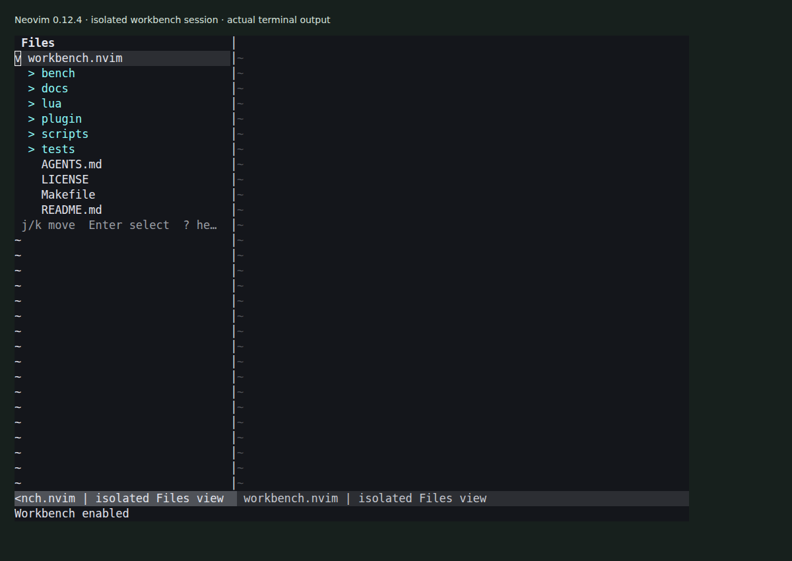

# workbench.nvim

A Neovim workspace plugin with file browsing, search, outlines and diagnostics
views. Enable it explicitly when you want to use it, then disable it to release
its views and resources.



The screenshot shows the current source running in an isolated Neovim session.
It demonstrates the Files view, not a completed host rollout or every provider.
See [the capture notes](docs/demo/README.md).

## Try the development plugin

The development branch is `dev`. With Neovim's native package layout:

```sh
git clone --branch dev https://github.com/olegpustovit/workbench.nvim.git \
  ~/.local/share/nvim/site/pack/workbench/start/workbench.nvim
```

Restart Neovim, then run:

```vim
:Workbench enable
:Workbench files
```

This is development software under integration validation. The capture used
Neovim 0.12.4. The repository also contains a harness for Neovim 0.11.7.
The default state is disabled; installation alone does not enable the views.

## Commands

| Command | Result |
| --- | --- |
| `:Workbench` | Show status |
| `:Workbench enable` | Enable the plugin |
| `:Workbench files` | Open the Files view |
| `:Workbench search` | Open Search |
| `:Workbench outline` | Open Outline |
| `:Workbench problems` | Open Problems |
| `:Workbench close` | Close a view |
| `:Workbench disable` | Disable the plugin and dispose its owned resources |

Provider availability depends on the environment. See
[provider requirements](docs/PROVIDERS.md) and
[interaction contracts](docs/UX.md). The plugin can run independently of
`autoconf.nvim` and `themekit.nvim`; those integrations add settings and theme
mappings. Nix installation and integration into an existing configuration are
separate from cloning this repository.

## Development

[Architecture](docs/ARCHITECTURE.md), [contracts](docs/CONTRACTS.md),
[implementation plan](docs/PLAN.md) and [validation](docs/VALIDATION.md) hold the
engineering detail. Agent work follows [AGENTS.md](AGENTS.md).

```sh
make bootstrap
make test
make test-integration
make test-ui
make test-e2e
```

The harness uses local Neovim instances and development-only dependencies.
Planning checks validate the plan, not runtime behavior. The screenshot does not
replace release, compatibility or performance checks. No GitHub CI is configured.

## License

[MIT](LICENSE).
